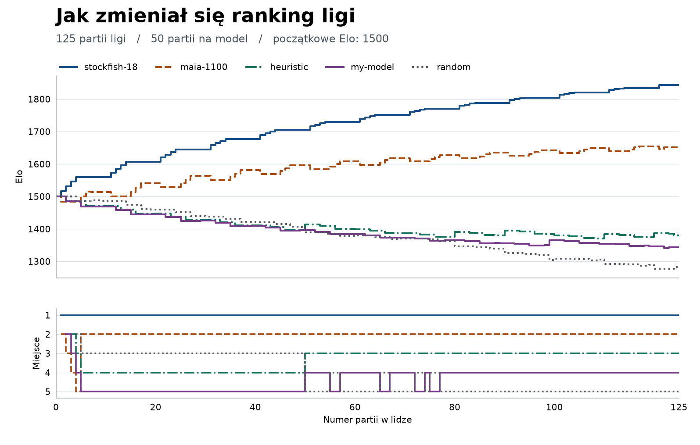

# Liga 01 · 50 partii na model

125 partii, pięć modeli. Każdy model rozegrał 25 partii białymi i 25 czarnymi. Każda para spotkała się 12 lub 13 razy. Zachowano pierwsze 20 partii sezonu, tę samą pozycję wyjściową i ustawienia silników. Wszystkie partie zakończyły się na planszy.

## Klasyfikacja końcowa

| Miejsce | Model | Wygrane | Remisy | Przegrane | Punkty | Elo |
|---:|---|---:|---:|---:|---:|---:|
| 1 | [stockfish-18](#stockfish-18) | 50 | 0 | 0 | 50 | 1844 |
| 2 | [maia-1100](#maia-1100) | 36 | 1 | 13 | 36.5 | 1651 |
| 3 | [heuristic](#heuristic) | 5 | 21 | 24 | 15.5 | 1380 |
| 4 | [my-model](#my-model) | 1 | 24 | 25 | 13 | 1344 |
| 5 | [random](#random) | 0 | 20 | 30 | 10 | 1281 |

Wszyscy startowali z 1500 Elo. Po każdej partii ranking obu uczestników aktualizowano ze współczynnikiem K=32. Tabela każdego gracza pokazuje jego miejsce w całej lidze tuż po własnej partii. Wykres uwzględnia również zmiany miejsca po partiach pozostałych zawodników. Przy identycznym Elo kolejność jest alfabetyczna.

Numery ligowe w tabelach prowadzą do zapisów poszczególnych partii. [Pobierz wszystkie partie w PGN](partie.pgn).

## stockfish-18

| Partia modelu | Nr w lidze | Kolor | Przeciwnik | Wynik modelu | Elo po partii | Zmiana Elo | Miejsce |
|---:|---:|---|---|---|---:|---:|---:|
| 1 | [1](partie.pgn#L1) | białe | maia-1100 | wygrana | 1516.00 | +16.00 | 1 |
| 2 | [2](partie.pgn#L12) | czarne | my-model | wygrana | 1531.26 | +15.26 | 1 |
| 3 | [3](partie.pgn#L23) | białe | heuristic | wygrana | 1545.83 | +14.56 | 1 |
| 4 | [4](partie.pgn#L34) | czarne | random | wygrana | 1559.73 | +13.90 | 1 |
| 5 | [11](partie.pgn#L111) | czarne | maia-1100 | wygrana | 1573.64 | +13.91 | 1 |
| 6 | [12](partie.pgn#L122) | białe | my-model | wygrana | 1584.98 | +11.35 | 1 |
| 7 | [13](partie.pgn#L133) | czarne | heuristic | wygrana | 1595.91 | +10.92 | 1 |
| 8 | [14](partie.pgn#L144) | białe | random | wygrana | 1607.00 | +11.09 | 1 |
| 9 | [21](partie.pgn#L221) | białe | maia-1100 | wygrana | 1620.01 | +13.01 | 1 |
| 10 | [22](partie.pgn#L232) | czarne | my-model | wygrana | 1628.57 | +8.56 | 1 |
| 11 | [23](partie.pgn#L243) | białe | heuristic | wygrana | 1636.89 | +8.32 | 1 |
| 12 | [24](partie.pgn#L254) | czarne | random | wygrana | 1645.38 | +8.48 | 1 |
| 13 | [31](partie.pgn#L331) | czarne | maia-1100 | wygrana | 1657.66 | +12.28 | 1 |
| 14 | [32](partie.pgn#L342) | białe | my-model | wygrana | 1664.31 | +6.66 | 1 |
| 15 | [33](partie.pgn#L353) | czarne | heuristic | wygrana | 1670.84 | +6.52 | 1 |
| 16 | [34](partie.pgn#L364) | białe | random | wygrana | 1677.49 | +6.65 | 1 |
| 17 | [41](partie.pgn#L441) | białe | maia-1100 | wygrana | 1689.15 | +11.66 | 1 |
| 18 | [42](partie.pgn#L452) | czarne | my-model | wygrana | 1694.48 | +5.33 | 1 |
| 19 | [43](partie.pgn#L463) | białe | heuristic | wygrana | 1699.72 | +5.25 | 1 |
| 20 | [44](partie.pgn#L474) | czarne | random | wygrana | 1705.08 | +5.35 | 1 |
| 21 | [51](partie.pgn#L551) | czarne | maia-1100 | wygrana | 1716.19 | +11.11 | 1 |
| 22 | [52](partie.pgn#L562) | białe | my-model | wygrana | 1720.56 | +4.37 | 1 |
| 23 | [53](partie.pgn#L573) | czarne | heuristic | wygrana | 1725.23 | +4.68 | 1 |
| 24 | [54](partie.pgn#L584) | białe | random | wygrana | 1729.29 | +4.05 | 1 |
| 25 | [61](partie.pgn#L661) | białe | maia-1100 | wygrana | 1739.91 | +10.62 | 1 |
| 26 | [62](partie.pgn#L672) | czarne | my-model | wygrana | 1743.56 | +3.65 | 1 |
| 27 | [63](partie.pgn#L683) | białe | heuristic | wygrana | 1747.43 | +3.87 | 1 |
| 28 | [64](partie.pgn#L694) | czarne | random | wygrana | 1750.87 | +3.44 | 1 |
| 29 | [71](partie.pgn#L771) | czarne | maia-1100 | wygrana | 1761.05 | +10.17 | 1 |
| 30 | [72](partie.pgn#L782) | białe | my-model | wygrana | 1764.15 | +3.11 | 1 |
| 31 | [73](partie.pgn#L793) | czarne | heuristic | wygrana | 1767.42 | +3.27 | 1 |
| 32 | [74](partie.pgn#L804) | białe | random | wygrana | 1770.38 | +2.96 | 1 |
| 33 | [81](partie.pgn#L881) | białe | maia-1100 | wygrana | 1780.14 | +9.76 | 1 |
| 34 | [82](partie.pgn#L892) | czarne | my-model | wygrana | 1782.82 | +2.68 | 1 |
| 35 | [83](partie.pgn#L903) | białe | heuristic | wygrana | 1785.86 | +3.04 | 1 |
| 36 | [84](partie.pgn#L914) | czarne | random | wygrana | 1788.22 | +2.36 | 1 |
| 37 | [91](partie.pgn#L991) | czarne | maia-1100 | wygrana | 1797.60 | +9.38 | 1 |
| 38 | [92](partie.pgn#L1002) | białe | my-model | wygrana | 1799.94 | +2.34 | 1 |
| 39 | [93](partie.pgn#L1013) | czarne | heuristic | wygrana | 1802.77 | +2.83 | 1 |
| 40 | [94](partie.pgn#L1024) | białe | random | wygrana | 1804.70 | +1.93 | 1 |
| 41 | [101](partie.pgn#L1101) | białe | maia-1100 | wygrana | 1813.72 | +9.02 | 1 |
| 42 | [102](partie.pgn#L1112) | czarne | my-model | wygrana | 1815.96 | +2.24 | 1 |
| 43 | [103](partie.pgn#L1123) | białe | heuristic | wygrana | 1818.37 | +2.41 | 1 |
| 44 | [104](partie.pgn#L1134) | czarne | random | wygrana | 1819.98 | +1.61 | 1 |
| 45 | [111](partie.pgn#L1211) | czarne | maia-1100 | wygrana | 1828.68 | +8.69 | 1 |
| 46 | [112](partie.pgn#L1222) | białe | my-model | wygrana | 1830.64 | +1.97 | 1 |
| 47 | [113](partie.pgn#L1233) | czarne | heuristic | wygrana | 1832.92 | +2.27 | 1 |
| 48 | [114](partie.pgn#L1244) | białe | random | wygrana | 1834.28 | +1.36 | 1 |
| 49 | [121](partie.pgn#L1321) | białe | maia-1100 | wygrana | 1842.67 | +8.39 | 1 |
| 50 | [125](partie.pgn#L1365) | czarne | random | wygrana | 1843.89 | +1.23 | 1 |

## maia-1100

| Partia modelu | Nr w lidze | Kolor | Przeciwnik | Wynik modelu | Elo po partii | Zmiana Elo | Miejsce |
|---:|---:|---|---|---|---:|---:|---:|
| 1 | [1](partie.pgn#L1) | czarne | stockfish-18 | przegrana | 1484.00 | -16.00 | 2 |
| 2 | [5](partie.pgn#L45) | białe | my-model | wygrana | 1500.03 | +16.03 | 2 |
| 3 | [6](partie.pgn#L56) | czarne | heuristic | wygrana | 1515.36 | +15.33 | 2 |
| 4 | [7](partie.pgn#L67) | białe | random | remis | 1514.02 | -1.34 | 2 |
| 5 | [11](partie.pgn#L111) | białe | stockfish-18 | przegrana | 1500.11 | -13.91 | 2 |
| 6 | [15](partie.pgn#L155) | czarne | my-model | wygrana | 1514.19 | +14.08 | 2 |
| 7 | [16](partie.pgn#L166) | białe | heuristic | wygrana | 1527.71 | +13.52 | 2 |
| 8 | [17](partie.pgn#L177) | czarne | random | wygrana | 1541.29 | +13.58 | 2 |
| 9 | [21](partie.pgn#L221) | czarne | stockfish-18 | przegrana | 1528.28 | -13.01 | 2 |
| 10 | [25](partie.pgn#L265) | białe | my-model | wygrana | 1540.15 | +11.87 | 2 |
| 11 | [26](partie.pgn#L276) | czarne | heuristic | wygrana | 1551.60 | +11.45 | 2 |
| 12 | [27](partie.pgn#L287) | białe | random | wygrana | 1563.11 | +11.50 | 2 |
| 13 | [31](partie.pgn#L331) | białe | stockfish-18 | przegrana | 1550.82 | -12.28 | 2 |
| 14 | [35](partie.pgn#L375) | czarne | my-model | wygrana | 1561.02 | +10.20 | 2 |
| 15 | [36](partie.pgn#L386) | białe | heuristic | wygrana | 1570.90 | +9.88 | 2 |
| 16 | [37](partie.pgn#L397) | czarne | random | wygrana | 1580.82 | +9.92 | 2 |
| 17 | [41](partie.pgn#L441) | czarne | stockfish-18 | przegrana | 1569.16 | -11.66 | 2 |
| 18 | [45](partie.pgn#L485) | białe | my-model | wygrana | 1578.08 | +8.92 | 2 |
| 19 | [46](partie.pgn#L496) | czarne | heuristic | wygrana | 1586.76 | +8.68 | 2 |
| 20 | [47](partie.pgn#L507) | białe | random | wygrana | 1595.45 | +8.70 | 2 |
| 21 | [51](partie.pgn#L551) | białe | stockfish-18 | przegrana | 1584.34 | -11.11 | 2 |
| 22 | [55](partie.pgn#L595) | czarne | my-model | wygrana | 1592.26 | +7.93 | 2 |
| 23 | [56](partie.pgn#L606) | białe | heuristic | wygrana | 1600.54 | +8.27 | 2 |
| 24 | [57](partie.pgn#L617) | czarne | random | wygrana | 1607.74 | +7.20 | 2 |
| 25 | [61](partie.pgn#L661) | czarne | stockfish-18 | przegrana | 1597.12 | -10.62 | 2 |
| 26 | [65](partie.pgn#L705) | białe | my-model | wygrana | 1604.26 | +7.14 | 2 |
| 27 | [66](partie.pgn#L716) | czarne | heuristic | wygrana | 1611.65 | +7.39 | 2 |
| 28 | [67](partie.pgn#L727) | białe | random | wygrana | 1618.21 | +6.57 | 2 |
| 29 | [71](partie.pgn#L771) | białe | stockfish-18 | przegrana | 1608.04 | -10.17 | 2 |
| 30 | [75](partie.pgn#L815) | czarne | my-model | wygrana | 1614.54 | +6.50 | 2 |
| 31 | [76](partie.pgn#L826) | białe | heuristic | wygrana | 1621.23 | +6.68 | 2 |
| 32 | [77](partie.pgn#L837) | czarne | random | wygrana | 1627.26 | +6.04 | 2 |
| 33 | [81](partie.pgn#L881) | czarne | stockfish-18 | przegrana | 1617.50 | -9.76 | 2 |
| 34 | [85](partie.pgn#L925) | białe | my-model | wygrana | 1623.48 | +5.97 | 2 |
| 35 | [86](partie.pgn#L936) | czarne | heuristic | wygrana | 1630.04 | +6.57 | 2 |
| 36 | [87](partie.pgn#L947) | białe | random | wygrana | 1635.22 | +5.18 | 2 |
| 37 | [91](partie.pgn#L991) | białe | stockfish-18 | przegrana | 1625.84 | -9.38 | 2 |
| 38 | [95](partie.pgn#L1035) | czarne | my-model | wygrana | 1631.37 | +5.53 | 2 |
| 39 | [96](partie.pgn#L1046) | białe | heuristic | wygrana | 1637.81 | +6.44 | 2 |
| 40 | [97](partie.pgn#L1057) | czarne | random | wygrana | 1642.32 | +4.51 | 2 |
| 41 | [101](partie.pgn#L1101) | czarne | stockfish-18 | przegrana | 1633.30 | -9.02 | 2 |
| 42 | [105](partie.pgn#L1145) | białe | my-model | wygrana | 1638.86 | +5.56 | 2 |
| 43 | [106](partie.pgn#L1156) | czarne | heuristic | wygrana | 1644.68 | +5.82 | 2 |
| 44 | [107](partie.pgn#L1167) | białe | random | wygrana | 1648.68 | +4.00 | 2 |
| 45 | [111](partie.pgn#L1211) | białe | stockfish-18 | przegrana | 1639.98 | -8.69 | 2 |
| 46 | [115](partie.pgn#L1255) | czarne | my-model | wygrana | 1645.13 | +5.15 | 2 |
| 47 | [116](partie.pgn#L1266) | białe | heuristic | wygrana | 1650.90 | +5.76 | 2 |
| 48 | [117](partie.pgn#L1277) | czarne | random | wygrana | 1654.47 | +3.58 | 2 |
| 49 | [121](partie.pgn#L1321) | czarne | stockfish-18 | przegrana | 1646.09 | -8.39 | 2 |
| 50 | [122](partie.pgn#L1332) | białe | my-model | wygrana | 1650.92 | +4.84 | 2 |

## heuristic

| Partia modelu | Nr w lidze | Kolor | Przeciwnik | Wynik modelu | Elo po partii | Zmiana Elo | Miejsce |
|---:|---:|---|---|---|---:|---:|---:|
| 1 | [3](partie.pgn#L23) | czarne | stockfish-18 | przegrana | 1485.44 | -14.56 | 2 |
| 2 | [6](partie.pgn#L56) | białe | maia-1100 | przegrana | 1470.11 | -15.33 | 4 |
| 3 | [8](partie.pgn#L78) | czarne | my-model | remis | 1470.04 | -0.06 | 4 |
| 4 | [10](partie.pgn#L100) | białe | random | remis | 1470.80 | +0.76 | 4 |
| 5 | [13](partie.pgn#L133) | białe | stockfish-18 | przegrana | 1459.88 | -10.92 | 4 |
| 6 | [16](partie.pgn#L166) | czarne | maia-1100 | przegrana | 1446.36 | -13.52 | 4 |
| 7 | [18](partie.pgn#L188) | białe | my-model | remis | 1446.26 | -0.10 | 4 |
| 8 | [20](partie.pgn#L210) | czarne | random | remis | 1446.91 | +0.65 | 4 |
| 9 | [23](partie.pgn#L243) | czarne | stockfish-18 | przegrana | 1438.59 | -8.32 | 4 |
| 10 | [26](partie.pgn#L276) | białe | maia-1100 | przegrana | 1427.14 | -11.45 | 4 |
| 11 | [28](partie.pgn#L298) | czarne | my-model | remis | 1427.02 | -0.12 | 4 |
| 12 | [30](partie.pgn#L320) | białe | random | remis | 1427.58 | +0.55 | 4 |
| 13 | [33](partie.pgn#L353) | białe | stockfish-18 | przegrana | 1421.06 | -6.52 | 4 |
| 14 | [36](partie.pgn#L386) | czarne | maia-1100 | przegrana | 1411.17 | -9.88 | 4 |
| 15 | [38](partie.pgn#L408) | białe | my-model | remis | 1411.05 | -0.12 | 4 |
| 16 | [40](partie.pgn#L430) | czarne | random | remis | 1411.53 | +0.47 | 4 |
| 17 | [43](partie.pgn#L463) | czarne | stockfish-18 | przegrana | 1406.28 | -5.25 | 4 |
| 18 | [46](partie.pgn#L496) | białe | maia-1100 | przegrana | 1397.60 | -8.68 | 4 |
| 19 | [48](partie.pgn#L518) | czarne | my-model | remis | 1397.49 | -0.12 | 4 |
| 20 | [50](partie.pgn#L540) | białe | random | wygrana | 1413.89 | +16.40 | 3 |
| 21 | [53](partie.pgn#L573) | białe | stockfish-18 | przegrana | 1409.22 | -4.68 | 3 |
| 22 | [56](partie.pgn#L606) | czarne | maia-1100 | przegrana | 1400.94 | -8.27 | 3 |
| 23 | [58](partie.pgn#L628) | białe | my-model | remis | 1400.14 | -0.81 | 3 |
| 24 | [60](partie.pgn#L650) | czarne | random | remis | 1399.16 | -0.98 | 3 |
| 25 | [63](partie.pgn#L683) | czarne | stockfish-18 | przegrana | 1395.28 | -3.87 | 3 |
| 26 | [66](partie.pgn#L716) | białe | maia-1100 | przegrana | 1387.89 | -7.39 | 3 |
| 27 | [68](partie.pgn#L738) | czarne | my-model | remis | 1387.22 | -0.68 | 3 |
| 28 | [70](partie.pgn#L760) | białe | random | remis | 1386.43 | -0.79 | 3 |
| 29 | [73](partie.pgn#L793) | białe | stockfish-18 | przegrana | 1383.16 | -3.27 | 3 |
| 30 | [76](partie.pgn#L826) | czarne | maia-1100 | przegrana | 1376.48 | -6.68 | 3 |
| 31 | [78](partie.pgn#L848) | białe | my-model | remis | 1375.91 | -0.57 | 3 |
| 32 | [80](partie.pgn#L870) | czarne | random | wygrana | 1391.26 | +15.36 | 3 |
| 33 | [83](partie.pgn#L903) | czarne | stockfish-18 | przegrana | 1388.22 | -3.04 | 3 |
| 34 | [86](partie.pgn#L936) | białe | maia-1100 | przegrana | 1381.66 | -6.57 | 3 |
| 35 | [88](partie.pgn#L958) | czarne | my-model | remis | 1380.47 | -1.19 | 3 |
| 36 | [90](partie.pgn#L980) | białe | random | wygrana | 1394.61 | +14.14 | 3 |
| 37 | [93](partie.pgn#L1013) | białe | stockfish-18 | przegrana | 1391.78 | -2.83 | 3 |
| 38 | [96](partie.pgn#L1046) | czarne | maia-1100 | przegrana | 1385.34 | -6.44 | 3 |
| 39 | [98](partie.pgn#L1068) | białe | my-model | remis | 1383.65 | -1.70 | 3 |
| 40 | [100](partie.pgn#L1090) | czarne | random | remis | 1380.07 | -3.57 | 3 |
| 41 | [103](partie.pgn#L1123) | czarne | stockfish-18 | przegrana | 1377.67 | -2.41 | 3 |
| 42 | [106](partie.pgn#L1156) | białe | maia-1100 | przegrana | 1371.85 | -5.82 | 3 |
| 43 | [108](partie.pgn#L1178) | czarne | my-model | remis | 1371.15 | -0.69 | 3 |
| 44 | [110](partie.pgn#L1200) | białe | random | wygrana | 1384.15 | +13.00 | 3 |
| 45 | [113](partie.pgn#L1233) | białe | stockfish-18 | przegrana | 1381.88 | -2.27 | 3 |
| 46 | [116](partie.pgn#L1266) | czarne | maia-1100 | przegrana | 1376.11 | -5.76 | 3 |
| 47 | [118](partie.pgn#L1288) | białe | my-model | remis | 1374.82 | -1.30 | 3 |
| 48 | [120](partie.pgn#L1310) | czarne | random | wygrana | 1386.99 | +12.17 | 3 |
| 49 | [123](partie.pgn#L1343) | czarne | my-model | remis | 1384.91 | -2.08 | 3 |
| 50 | [124](partie.pgn#L1354) | białe | random | remis | 1380.13 | -4.78 | 3 |

## my-model

| Partia modelu | Nr w lidze | Kolor | Przeciwnik | Wynik modelu | Elo po partii | Zmiana Elo | Miejsce |
|---:|---:|---|---|---|---:|---:|---:|
| 1 | [2](partie.pgn#L12) | białe | stockfish-18 | przegrana | 1484.74 | -15.26 | 2 |
| 2 | [5](partie.pgn#L45) | czarne | maia-1100 | przegrana | 1468.70 | -16.03 | 5 |
| 3 | [8](partie.pgn#L78) | białe | heuristic | remis | 1468.77 | +0.06 | 5 |
| 4 | [9](partie.pgn#L89) | czarne | random | remis | 1469.63 | +0.86 | 5 |
| 5 | [12](partie.pgn#L122) | czarne | stockfish-18 | przegrana | 1458.28 | -11.35 | 5 |
| 6 | [15](partie.pgn#L155) | białe | maia-1100 | przegrana | 1444.20 | -14.08 | 5 |
| 7 | [18](partie.pgn#L188) | czarne | heuristic | remis | 1444.30 | +0.10 | 5 |
| 8 | [19](partie.pgn#L199) | białe | random | remis | 1445.07 | +0.78 | 5 |
| 9 | [22](partie.pgn#L232) | białe | stockfish-18 | przegrana | 1436.51 | -8.56 | 5 |
| 10 | [25](partie.pgn#L265) | czarne | maia-1100 | przegrana | 1424.64 | -11.87 | 5 |
| 11 | [28](partie.pgn#L298) | białe | heuristic | remis | 1424.75 | +0.12 | 5 |
| 12 | [29](partie.pgn#L309) | czarne | random | remis | 1425.44 | +0.69 | 5 |
| 13 | [32](partie.pgn#L342) | czarne | stockfish-18 | przegrana | 1418.79 | -6.66 | 5 |
| 14 | [35](partie.pgn#L375) | białe | maia-1100 | przegrana | 1408.59 | -10.20 | 5 |
| 15 | [38](partie.pgn#L408) | czarne | heuristic | remis | 1408.71 | +0.12 | 5 |
| 16 | [39](partie.pgn#L419) | białe | random | remis | 1409.32 | +0.61 | 5 |
| 17 | [42](partie.pgn#L452) | białe | stockfish-18 | przegrana | 1403.99 | -5.33 | 5 |
| 18 | [45](partie.pgn#L485) | czarne | maia-1100 | przegrana | 1395.07 | -8.92 | 5 |
| 19 | [48](partie.pgn#L518) | białe | heuristic | remis | 1395.19 | +0.12 | 5 |
| 20 | [49](partie.pgn#L529) | czarne | random | remis | 1395.72 | +0.53 | 5 |
| 21 | [52](partie.pgn#L562) | czarne | stockfish-18 | przegrana | 1391.35 | -4.37 | 4 |
| 22 | [55](partie.pgn#L595) | białe | maia-1100 | przegrana | 1383.43 | -7.93 | 5 |
| 23 | [58](partie.pgn#L628) | czarne | heuristic | remis | 1384.23 | +0.81 | 4 |
| 24 | [59](partie.pgn#L639) | białe | random | remis | 1383.97 | -0.26 | 4 |
| 25 | [62](partie.pgn#L672) | białe | stockfish-18 | przegrana | 1380.32 | -3.65 | 4 |
| 26 | [65](partie.pgn#L705) | czarne | maia-1100 | przegrana | 1373.18 | -7.14 | 5 |
| 27 | [68](partie.pgn#L738) | białe | heuristic | remis | 1373.86 | +0.68 | 4 |
| 28 | [69](partie.pgn#L749) | czarne | random | remis | 1373.68 | -0.19 | 4 |
| 29 | [72](partie.pgn#L782) | czarne | stockfish-18 | przegrana | 1370.57 | -3.11 | 5 |
| 30 | [75](partie.pgn#L815) | białe | maia-1100 | przegrana | 1364.07 | -6.50 | 5 |
| 31 | [78](partie.pgn#L848) | czarne | heuristic | remis | 1364.64 | +0.57 | 4 |
| 32 | [79](partie.pgn#L859) | białe | random | remis | 1364.51 | -0.13 | 4 |
| 33 | [82](partie.pgn#L892) | białe | stockfish-18 | przegrana | 1361.83 | -2.68 | 4 |
| 34 | [85](partie.pgn#L925) | czarne | maia-1100 | przegrana | 1355.86 | -5.97 | 4 |
| 35 | [88](partie.pgn#L958) | białe | heuristic | remis | 1357.04 | +1.19 | 4 |
| 36 | [89](partie.pgn#L969) | czarne | random | remis | 1356.21 | -0.83 | 4 |
| 37 | [92](partie.pgn#L1002) | czarne | stockfish-18 | przegrana | 1353.88 | -2.34 | 4 |
| 38 | [95](partie.pgn#L1035) | białe | maia-1100 | przegrana | 1348.35 | -5.53 | 4 |
| 39 | [98](partie.pgn#L1068) | czarne | heuristic | remis | 1350.04 | +1.70 | 4 |
| 40 | [99](partie.pgn#L1079) | białe | random | wygrana | 1364.63 | +14.59 | 4 |
| 41 | [102](partie.pgn#L1112) | białe | stockfish-18 | przegrana | 1362.39 | -2.24 | 4 |
| 42 | [105](partie.pgn#L1145) | czarne | maia-1100 | przegrana | 1356.83 | -5.56 | 4 |
| 43 | [108](partie.pgn#L1178) | białe | heuristic | remis | 1357.52 | +0.69 | 4 |
| 44 | [109](partie.pgn#L1189) | czarne | random | remis | 1355.01 | -2.51 | 4 |
| 45 | [112](partie.pgn#L1222) | czarne | stockfish-18 | przegrana | 1353.05 | -1.97 | 4 |
| 46 | [115](partie.pgn#L1255) | białe | maia-1100 | przegrana | 1347.90 | -5.15 | 4 |
| 47 | [118](partie.pgn#L1288) | czarne | heuristic | remis | 1349.20 | +1.30 | 4 |
| 48 | [119](partie.pgn#L1299) | białe | random | remis | 1346.37 | -2.82 | 4 |
| 49 | [122](partie.pgn#L1332) | czarne | maia-1100 | przegrana | 1341.54 | -4.84 | 4 |
| 50 | [123](partie.pgn#L1343) | białe | heuristic | remis | 1343.62 | +2.08 | 4 |

## random

| Partia modelu | Nr w lidze | Kolor | Przeciwnik | Wynik modelu | Elo po partii | Zmiana Elo | Miejsce |
|---:|---:|---|---|---|---:|---:|---:|
| 1 | [4](partie.pgn#L34) | białe | stockfish-18 | przegrana | 1486.10 | -13.90 | 2 |
| 2 | [7](partie.pgn#L67) | czarne | maia-1100 | remis | 1487.44 | +1.34 | 3 |
| 3 | [9](partie.pgn#L89) | białe | my-model | remis | 1486.58 | -0.86 | 3 |
| 4 | [10](partie.pgn#L100) | czarne | heuristic | remis | 1485.82 | -0.76 | 3 |
| 5 | [14](partie.pgn#L144) | czarne | stockfish-18 | przegrana | 1474.73 | -11.09 | 3 |
| 6 | [17](partie.pgn#L177) | białe | maia-1100 | przegrana | 1461.15 | -13.58 | 3 |
| 7 | [19](partie.pgn#L199) | czarne | my-model | remis | 1460.37 | -0.78 | 3 |
| 8 | [20](partie.pgn#L210) | białe | heuristic | remis | 1459.73 | -0.65 | 3 |
| 9 | [24](partie.pgn#L254) | białe | stockfish-18 | przegrana | 1451.24 | -8.48 | 3 |
| 10 | [27](partie.pgn#L287) | czarne | maia-1100 | przegrana | 1439.74 | -11.50 | 3 |
| 11 | [29](partie.pgn#L309) | białe | my-model | remis | 1439.05 | -0.69 | 3 |
| 12 | [30](partie.pgn#L320) | czarne | heuristic | remis | 1438.50 | -0.55 | 3 |
| 13 | [34](partie.pgn#L364) | czarne | stockfish-18 | przegrana | 1431.84 | -6.65 | 3 |
| 14 | [37](partie.pgn#L397) | białe | maia-1100 | przegrana | 1421.93 | -9.92 | 3 |
| 15 | [39](partie.pgn#L419) | czarne | my-model | remis | 1421.32 | -0.61 | 3 |
| 16 | [40](partie.pgn#L430) | białe | heuristic | remis | 1420.85 | -0.47 | 3 |
| 17 | [44](partie.pgn#L474) | białe | stockfish-18 | przegrana | 1415.49 | -5.35 | 3 |
| 18 | [47](partie.pgn#L507) | czarne | maia-1100 | przegrana | 1406.80 | -8.70 | 3 |
| 19 | [49](partie.pgn#L529) | białe | my-model | remis | 1406.26 | -0.53 | 3 |
| 20 | [50](partie.pgn#L540) | czarne | heuristic | przegrana | 1389.86 | -16.40 | 5 |
| 21 | [54](partie.pgn#L584) | czarne | stockfish-18 | przegrana | 1385.81 | -4.05 | 5 |
| 22 | [57](partie.pgn#L617) | białe | maia-1100 | przegrana | 1378.60 | -7.20 | 5 |
| 23 | [59](partie.pgn#L639) | czarne | my-model | remis | 1378.86 | +0.26 | 5 |
| 24 | [60](partie.pgn#L650) | białe | heuristic | remis | 1379.84 | +0.98 | 5 |
| 25 | [64](partie.pgn#L694) | białe | stockfish-18 | przegrana | 1376.40 | -3.44 | 5 |
| 26 | [67](partie.pgn#L727) | czarne | maia-1100 | przegrana | 1369.83 | -6.57 | 5 |
| 27 | [69](partie.pgn#L749) | białe | my-model | remis | 1370.02 | +0.19 | 5 |
| 28 | [70](partie.pgn#L760) | czarne | heuristic | remis | 1370.81 | +0.79 | 5 |
| 29 | [74](partie.pgn#L804) | czarne | stockfish-18 | przegrana | 1367.85 | -2.96 | 5 |
| 30 | [77](partie.pgn#L837) | białe | maia-1100 | przegrana | 1361.81 | -6.04 | 5 |
| 31 | [79](partie.pgn#L859) | czarne | my-model | remis | 1361.94 | +0.13 | 5 |
| 32 | [80](partie.pgn#L870) | białe | heuristic | przegrana | 1346.58 | -15.36 | 5 |
| 33 | [84](partie.pgn#L914) | białe | stockfish-18 | przegrana | 1344.22 | -2.36 | 5 |
| 34 | [87](partie.pgn#L947) | czarne | maia-1100 | przegrana | 1339.04 | -5.18 | 5 |
| 35 | [89](partie.pgn#L969) | białe | my-model | remis | 1339.87 | +0.83 | 5 |
| 36 | [90](partie.pgn#L980) | czarne | heuristic | przegrana | 1325.73 | -14.14 | 5 |
| 37 | [94](partie.pgn#L1024) | czarne | stockfish-18 | przegrana | 1323.80 | -1.93 | 5 |
| 38 | [97](partie.pgn#L1057) | białe | maia-1100 | przegrana | 1319.29 | -4.51 | 5 |
| 39 | [99](partie.pgn#L1079) | czarne | my-model | przegrana | 1304.71 | -14.59 | 5 |
| 40 | [100](partie.pgn#L1090) | białe | heuristic | remis | 1308.28 | +3.57 | 5 |
| 41 | [104](partie.pgn#L1134) | białe | stockfish-18 | przegrana | 1306.67 | -1.61 | 5 |
| 42 | [107](partie.pgn#L1167) | czarne | maia-1100 | przegrana | 1302.67 | -4.00 | 5 |
| 43 | [109](partie.pgn#L1189) | białe | my-model | remis | 1305.17 | +2.51 | 5 |
| 44 | [110](partie.pgn#L1200) | czarne | heuristic | przegrana | 1292.17 | -13.00 | 5 |
| 45 | [114](partie.pgn#L1244) | czarne | stockfish-18 | przegrana | 1290.81 | -1.36 | 5 |
| 46 | [117](partie.pgn#L1277) | białe | maia-1100 | przegrana | 1287.24 | -3.58 | 5 |
| 47 | [119](partie.pgn#L1299) | czarne | my-model | remis | 1290.06 | +2.82 | 5 |
| 48 | [120](partie.pgn#L1310) | białe | heuristic | przegrana | 1277.89 | -12.17 | 5 |
| 49 | [124](partie.pgn#L1354) | czarne | heuristic | remis | 1282.66 | +4.78 | 5 |
| 50 | [125](partie.pgn#L1365) | białe | stockfish-18 | przegrana | 1281.44 | -1.23 | 5 |
